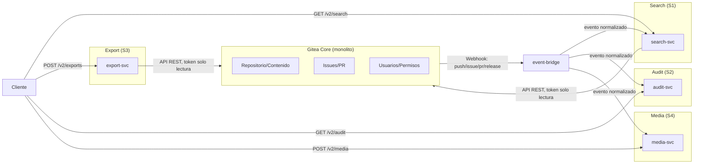

# F5-E3 — Mapa de contextos (DDD)

Para esta parte pensamos primero en qué pedazos de Gitea se pueden separar sin que dependan tanto uno del otro, y en base a eso armamos los "bounded contexts". Quedaron así:

- **Gitea Core**: el monolito tal cual, no se toca. Acá entra todo lo de repos, issues/PR y usuarios/permisos.
- **Search**: el nuevo S1, que arma su propio índice de búsqueda.
- **Audit**: el S2, que va armando un registro de actividad a partir de lo que le llega por eventos.
- **Export**: el S3, encargado de generar exportaciones sin bloquear nada mientras tanto.
- **Media**: el S4, que es opcional (lo vamos a hacer si nos alcanza el tiempo), maneja adjuntos y miniaturas aparte.

## Cómo se relacionan entre sí

## Un poco más de detalle de cada relación

No todos los servicios se relacionan igual con el monolito, así que fuimos viendo caso por caso:

**Search (S1)** básicamente se tiene que acomodar a como Gitea le entrega los datos, no le pedimos que cambie nada. En DDD esto se le dice patrón Conformist, porque el servicio "nuevo" se conforma con lo que ya existe.

**Audit (S2)** ni siquiera llama a la API de Gitea, solo escucha los webhooks que le llegan. Acá el que hace el trabajo pesado de traducir es el `event-bridge`, que actúa como una especie de capa anticorrupción (ACL para los que vieron la sigla en DDD) entre el formato nativo de Gitea y lo que nuestros servicios esperan recibir.

**Export (S3)** es parecido a Search, también es Conformist, porque cuando alguien pide exportar algo, el worker va y le pregunta a la API de Gitea los datos que necesita.

**Media (S4)**, en cambio, es más independiente. El almacenamiento de archivos en MinIO no necesita enterarse de cómo funciona Gitea por dentro, solo guarda el archivo con un ID de referencia y listo.

Algo para remarcar: justamente por eso pusimos tanto hincapié en el `event-bridge` en el ADR-006. Es el único lugar donde "vive" el conocimiento de cómo son los webhooks de Gitea tal cual los manda. Si el día de mañana sale una versión nueva de Gitea y cambia el formato del webhook, en teoría solo hay que arreglar ese componente y los demás servicios ni se enteran, porque ellos consumen nuestro propio formato de evento (el que definimos en `cna/contracts/`), no el de Gitea directamente.
