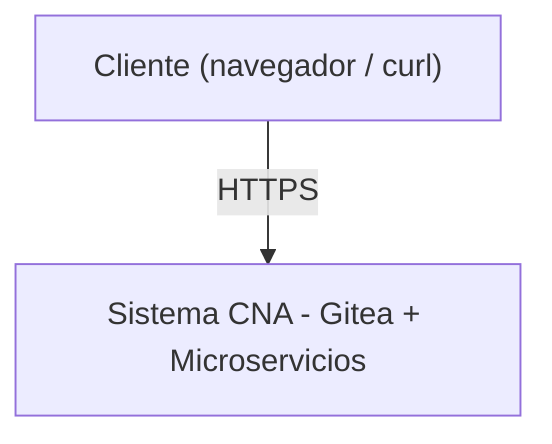
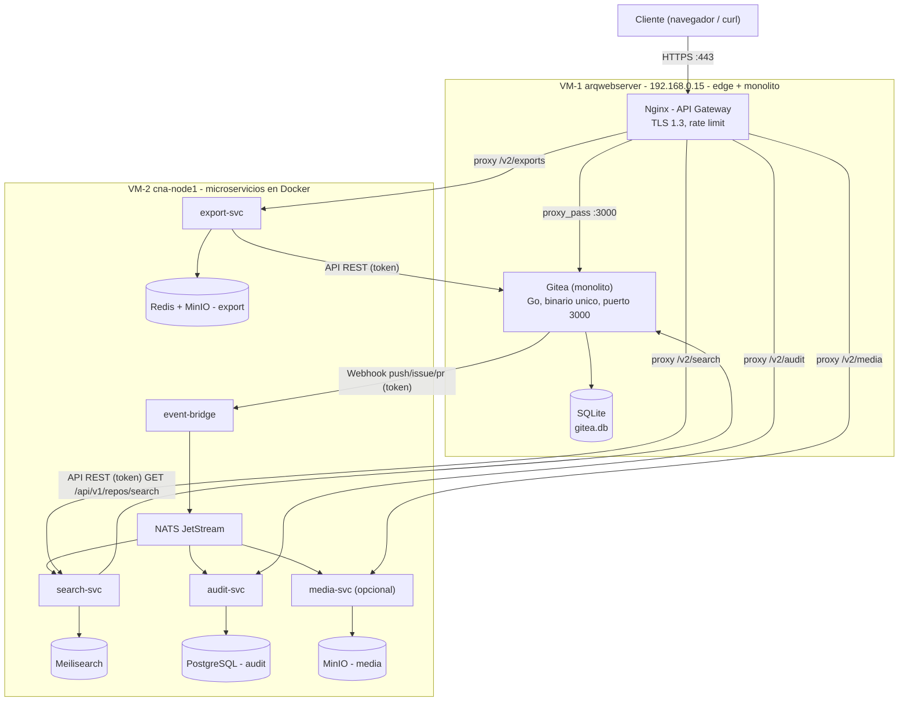

# F5-E5 y F5-E6 — Modelo C4

## F5-E5 — C4 Nivel 1 (Contexto)

A este nivel todo el sistema (monolito + microservicios + broker + observabilidad) se ve como una sola caja. No importa si lo que el cliente pide lo termina resolviendo Gitea directamente o uno de los microservicios nuevos, siempre entra por el mismo lado: HTTPS contra el gateway único (`api.gitea.local`).

## F5-E6 — C4 Nivel 2 (Contenedores)

Ojo: VM-3 (la de observabilidad, con Prometheus, Grafana, Loki y Jaeger) la fusionamos con VM-2 por el tema de RAM que ya explicamos en el ADR-008. Por eso no aparece como nodo aparte en este diagrama, va todo junto en VM-2.
