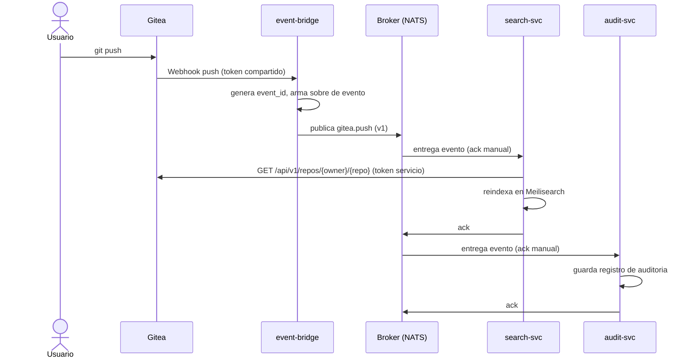
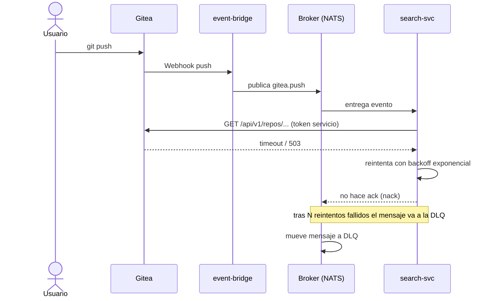
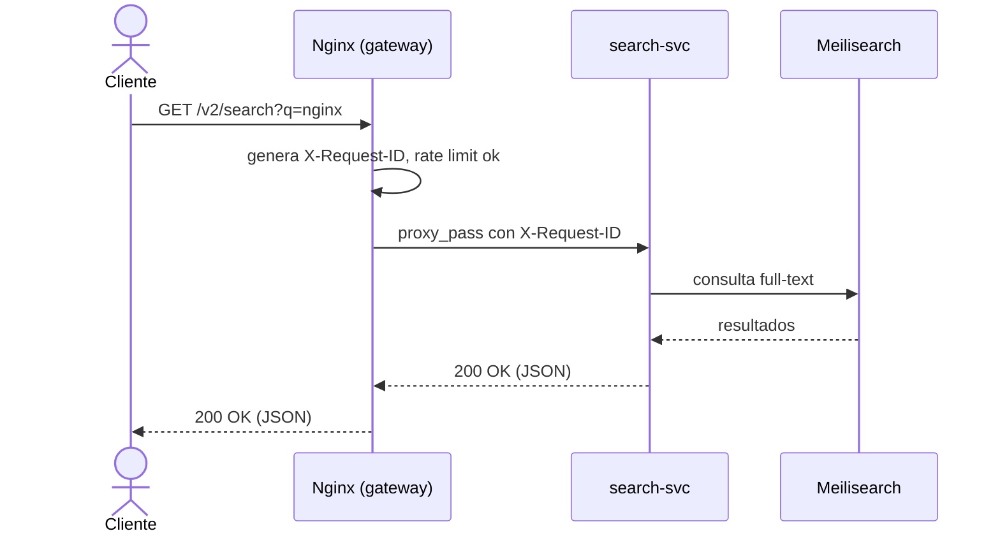
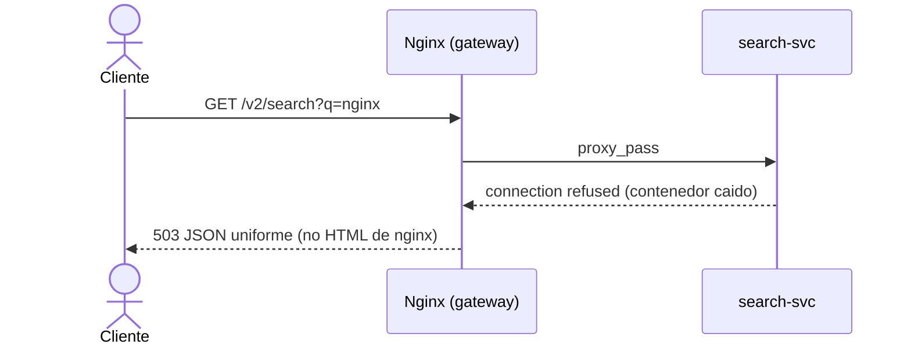
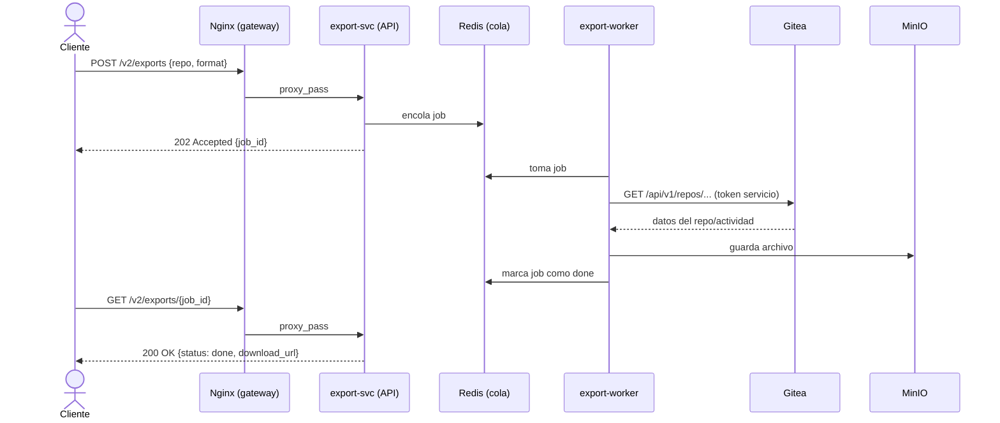
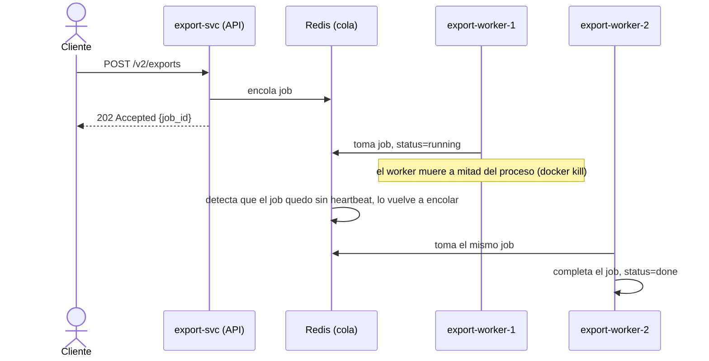

# F5-E7 — Diagramas de secuencia

Acá van las 3 interacciones obligatorias, cada una con su camino normal y con qué pasa cuando algo falla. Los armamos pensando en lo que de verdad vamos a tener que mostrar en la demo.

## 1. Push -> indexacion (asincrona)

### Camino feliz

### Camino de error

## 2. Busqueda (sincrona)

### Camino feliz

### Camino de error

## 3. Exportacion (asincrona por trabajos)

### Camino feliz

### Camino de error

